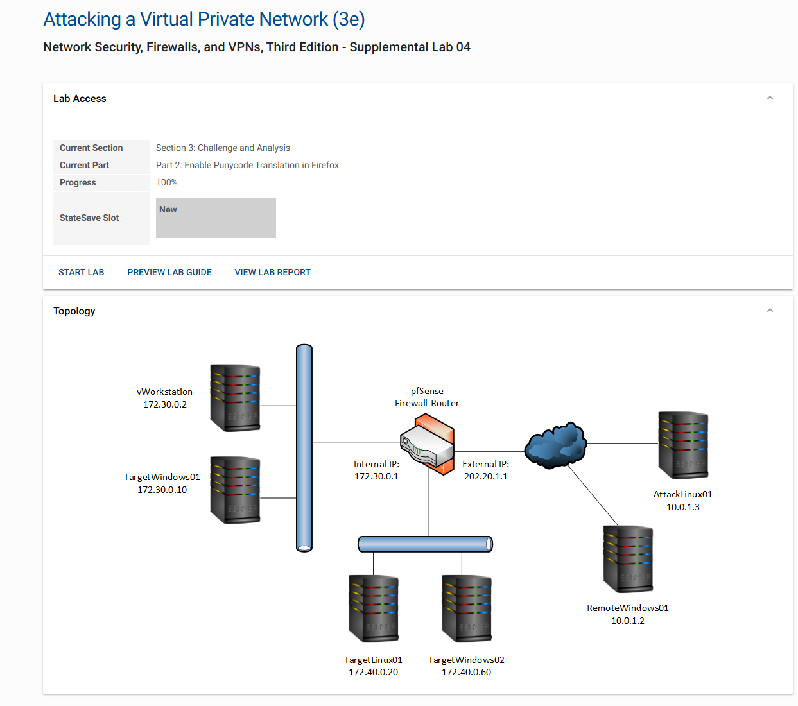
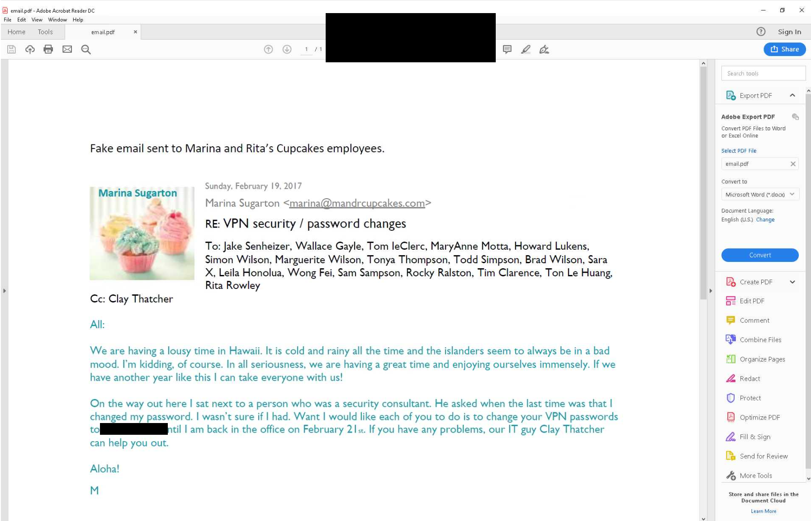
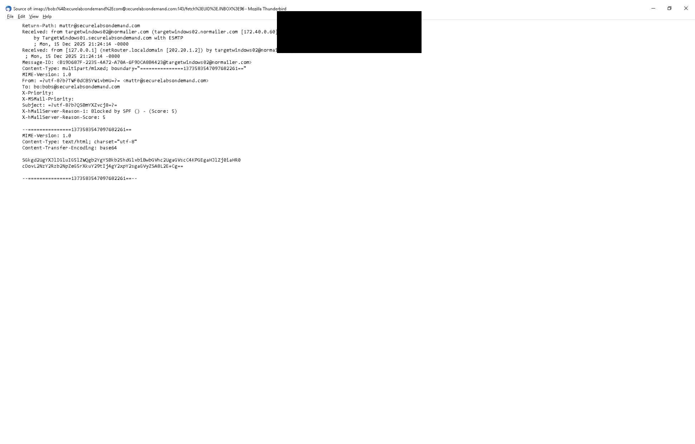
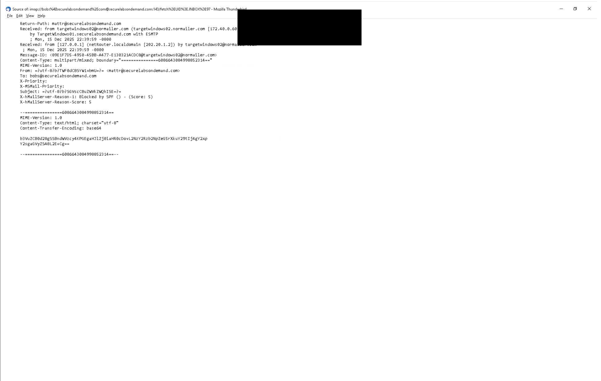
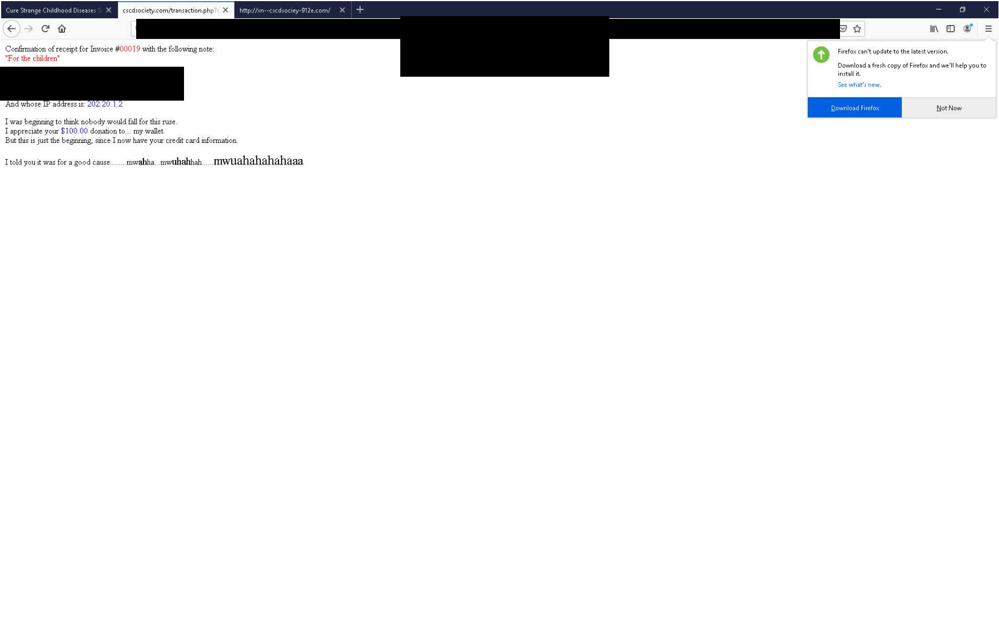
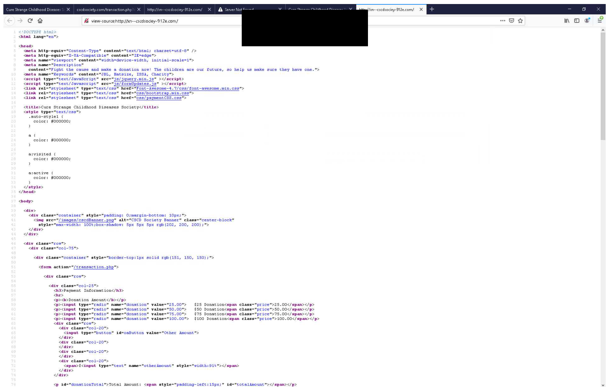
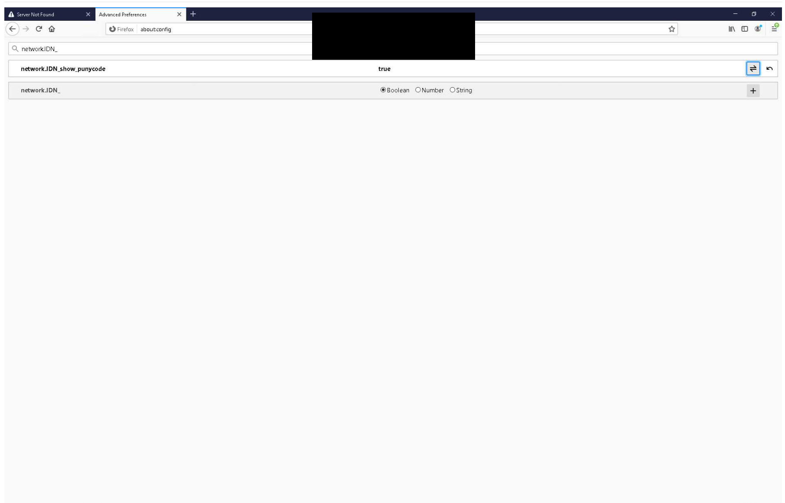
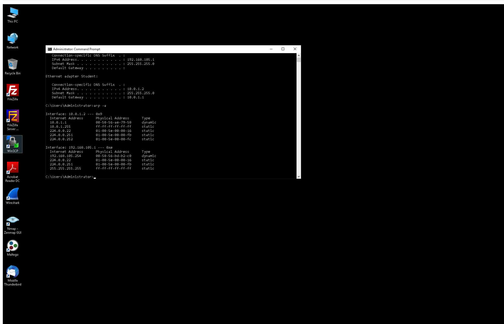
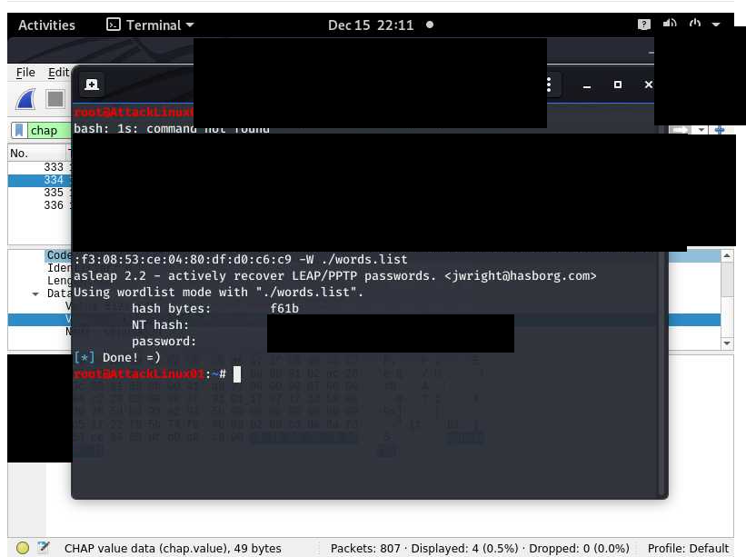

# VPN Security: Social Engineering and Authentication Analysis

**Author:** Marcus Draper  
**Environment:** Academic virtual lab  
**Tools shown:** Thunderbird, Firefox, Windows Command Prompt, Wireshark, chap2asleap, asleap  
**Scope:** Analysis of supplied training scenarios and lab results.

## Overview

This lab explored attacks against the people and authentication mechanisms surrounding remote access. I reviewed a simulated password-change email, inspected message source, examined a mock donation-site result and its source, checked client addressing and ARP entries, and recorded an offline password-recovery result from the training environment. I also changed a Firefox preference to display internationalized domain names as Punycode.

The course title is *Attacking a Virtual Private Network*. This portfolio focuses on the evidence and defensive lessons. No phishing messages were sent, websites deployed, or credentials attacked while preparing this repository.

## Skills demonstrated

- Recognizing impersonation and unsafe shared-password requests.
- Reading email headers, MIME fields, and mail-filter annotations.
- Inspecting a suspicious site's URL and HTML source.
- Recording local IP and ARP information without overclaiming an attack.
- Interpreting a lab authentication-recovery result.
- Redacting personal and credential data before publication.
- Distinguishing browser settings, observed outcomes, and mitigations still needing validation.

## Environment

| Component | Address shown in the training topology |
| --- | --- |
| vWorkstation | 172.30.0.2 |
| TargetWindows01 | 172.30.0.10 |
| pfSense LAN | 172.30.0.1 |
| pfSense WAN | 202.20.1.1 |
| AttackLinux01 | 10.0.1.3 |
| RemoteWindows01 | 10.0.1.2 |
| TargetLinux01 | 172.40.0.20 |
| TargetWindows02 | 172.40.0.60 |

Other views contain `202.20.1.2` in message headers and the mock-site result. Those values are retained as observed; no NAT or endpoint equivalence is assumed. Domain names in screenshots are training artifacts and are not provided as live targets.



## 1. Analyze the simulated password-change email

The supplied training PDF explicitly labels the message as fake. It impersonates a company leader and instructs employees to change their VPN passwords to one shared value while the sender is away. It combines familiar business context, a casual tone, and an apparent IT contact to make the request seem routine.

| Indicator | Security significance |
| --- | --- |
| One password requested for multiple employees | Removes individual credential secrecy and accountability |
| Password supplied directly in an email | Encourages disclosure and unsafe credential handling |
| Claimed authority and personal context | Makes an unusual request appear legitimate |
| Informal temporary exception | Encourages bypassing normal password-change procedures |

The simulated password is blocked out in the image. This is analysis of provided course material, not evidence that I sent this message or that actual employees followed it.



## 2. Inspect message source and filter annotations

Two Thunderbird source views show Return-Path, Received, From, To, MIME fields, a Base64-encoded HTML body, and these filter annotations:

```text
X-hMailServer-Reason-1: Blocked by SPF () - (Score: 5)
X-hMailServer-Reason-Score: 5
```

The visible Received chain includes the training mail host at `172.40.0.60` and another header referencing `202.20.1.2`.

The annotation records what the mail system reported. It does not prove SMTP rejection, inbox quarantine, or recipient behavior. The source being available in Thunderbird also does not, by itself, explain the final delivery disposition. No complete mail-server log or DNS policy is supplied.





The written lab response discusses DKIM and DMARC. It is retained here as a research topic, not as proof those controls were configured or tested. SPF checks, cryptographic message signing, and domain-policy enforcement should be evaluated separately; none should be described as a complete defense against every phishing scenario.

## 3. Review the simulated donation-site outcome

The browser result page identifies the transaction as a ruse and states that the entered information was obtained. It includes a displayed donation amount and echoed personal fields. I have blocked out the personal fields and URL query string containing submitted payment-form data.

This is a mock training transaction. The screenshot does not prove a real donation, financial charge, or external theft.



### Source inspection

The source view shows a donation form with an action pointing to `/transaction.php`, selectable amounts, a donation-total field, and JavaScript/CSS references. The browser address displays an `xn--` label. This supports inspection of an internationalized-domain training example; the exact Unicode rendering and character substitution are not independently established by the supplied source image.



## 4. Configure Punycode display in the lab browser

The Firefox Advanced Preferences screenshot shows:

```text
network.IDN_show_punycode = true
```

The preference is documented as observed in this historical lab browser. This repository is not a current browser-configuration guide. No controlled before-and-after visit is supplied to prove the display behavior changed for a particular hostname.



## 5. Record client addressing and ARP entries

The Windows output shows the Student adapter at `10.0.1.2`, subnet mask `255.255.255.0`, and default gateway `10.0.1.1`. The `arp -a` output lists a dynamic neighbor entry for that gateway and entries for a separate `192.168.105.1` interface.

```text
arp -a
```

This is local network-state evidence. The two supplied ARP screenshots show the same displayed gateway mapping. They do not establish ARP poisoning, interception, or a changed gateway identity, so one representative view is included.



## 6. Interpret the offline authentication-recovery result

The AttackLinux01 screenshot shows a CHAP-related capture in Wireshark behind a terminal. The terminal shows chap2asleap preparing input for asleap, a wordlist-based recovery run, and returned hash/password fields followed by a completion message.

Recovered credential values, hashes, and the challenge/response command data are blocked out. No wordlist, recovery script, hash file, credential, or raw capture is included in this repository.

The result supports successful recovery of a **lab credential**. It does not demonstrate a subsequent VPN login or prove that every CHAP-family implementation or every VPN can be compromised in the same way. The screenshot does not provide a complete negotiated-authentication record or sufficient details to claim a particular VPN version was exploited.



## Findings and proposed defenses

| Finding supported by the evidence | Proposed response | Validation still needed |
| --- | --- | --- |
| Simulated email requests a shared VPN password | Use individual credentials and verify password-change requests through an established channel | Test reporting and approved password-reset workflow |
| Message source includes an SPF-related filter annotation | Review mail authentication and delivery policy | Inspect DNS records, server logs, and final delivery disposition |
| Mock site echoes submitted information | Check destinations before submitting sensitive information and use approved payment/access portals | Controlled training test with dummy data |
| An internationalized-domain label is visible | Train users to inspect full hostnames and suspicious lookalikes | Capture before/after display and actual hostname characters |
| Offline recovery returns a lab password | Review authentication design, password strength, and additional factors | Identify the exact protocol, confirm exposure, and test approved mitigation |
| ARP entries were inspected | Establish known network baselines | Obtain packet/log evidence before claiming interception |

These are proposed improvements. The screenshots do not demonstrate that they were deployed or reduced risk.

## Evidence boundaries

- This is an isolated academic exercise. The repository presents analysis rather than an operational phishing or credential-attack toolkit.
- Mock itinerary/email materials contain historical scenario dates; screenshots were captured in the lab on December 15–16, 2025. They are not evidence of current real-world activity.
- The travel itinerary PDF is omitted because it supplies scenario context rather than a technical result.
- Two written answers are summarized rather than reproducing the complete assignment prompts.
- A duplicate ARP view is omitted; no before/after mapping change is claimed.
- No complete SMTP logs, raw captures, DKIM/DMARC configuration, or successful login using a recovered credential is supplied.
- Course progress shows 100%; technical conclusions remain limited to the evidence.

## Lessons learned

VPN protection depends on more than tunnel encryption. An unsafe password request or deceptive form can undermine access controls without breaking the tunnel. Message headers, endpoint information, browser behavior, and authentication results each provide a different piece of evidence. Accurate reporting keeps those pieces separate and does not turn an indicator into an unsupported claim of compromise.

## Files and attribution

All nine PNGs are beside README.md. See [EVIDENCE.md](EVIDENCE.md) and [UPLOAD.md](UPLOAD.md).

Based on **Attacking a Virtual Private Network (3e)**, *Network Security, Firewalls, and VPNs, Third Edition — Supplemental Lab 04*. The narrative documents academic work and training examples, not the full course guide. Third-party training and software content retain their respective ownership.
